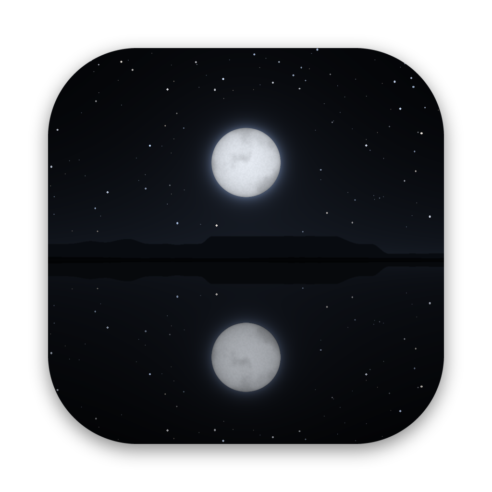
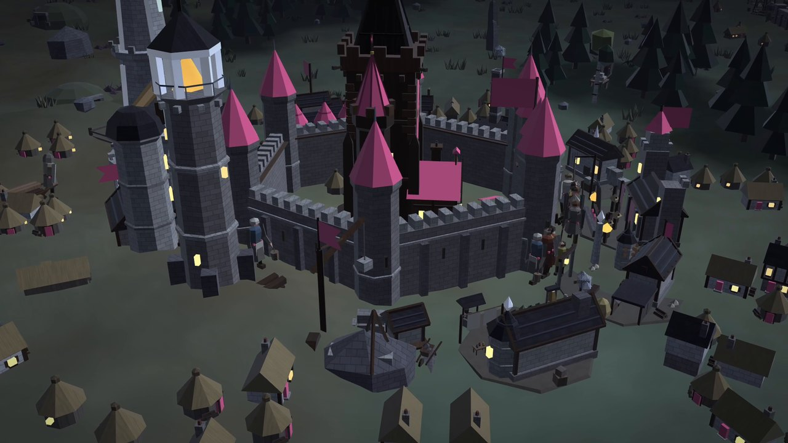
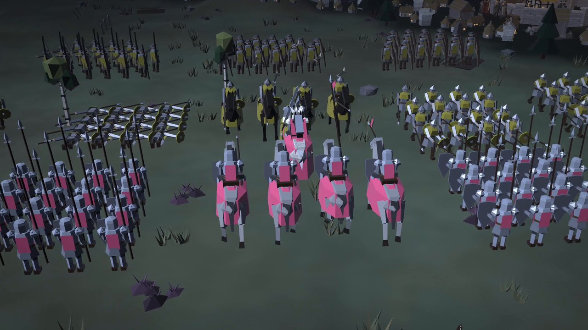

<p align="center">
  
</p>

<h1 align="center">Nullmere Online</h1>

<p align="center">
  A persistent strategy MMO for the Mac, on a still black lake under the moon.<br>
  <a href="https://github.com/ael-dev3/Nullmere/releases/tag/trailer"><b>Watch the trailer</b></a>
</p>

<p align="center">
  <a href="https://github.com/ael-dev3/Nullmere/releases/tag/trailer"></a>
</p>

Nullmere Online is one world shared by everyone who plays it: a great dead
lake, still as black glass under a full moon, ringed by the seats of twelve
Houses (a realm may be raised with up to a thousand and twenty-four). Each player is a
keeper and holds a House. Keepers found holds and work the land, raise works
and pursue studies, muster companies by the thousand under their commanders,
make and break pacts and alliances, and win the age by dominion over the
lake or by raising the Moonspire. The realm keeps the world on its server
and plays every House no keeper holds. When an age ends, its holds lie
drowned beneath the next age's lake, for new keepers to find.

It is a native Mac app for Apple silicon: SwiftUI and AppKit, every frame
drawn with Metal, every model made for this game alone, its score written as
it plays on recorded orchestral instruments, as are many of its cues, and its
night, its battles and its towns sounded in code. Envoys, a chronicler, a clerk who reads orders written in plain
words and the House's own commanders, taking counsel with their keeper,
speak through Apple's on-device model, on each keeper's own Mac. Nullmere
Companion, its iPhone app, keeps the keeper's House from their phone beside
their Mac, linked by a code the Mac shows: a chart of its land and its
borders, its works, musters and companies sent from the chart, its
commanders with their gear and stars, the Ring, the Spine and the Forge,
the caretaker's standing orders for while the keeper is away, the Lantern
Inn and the pedlar, letters to other keepers and to the age to come, the
watch's labours and the realm's happenings, its alliance's studies, help,
rallies and stores, its dealings with the Houses nearest (envoys, gifts,
trades and war), the realm's law, oaths, auguries, whispers and titles,
the Sundering and the Frontier, and counsel with its commanders and orders
in the keeper's own words, read by the phone's own on-device model. Out of
reach, it says so and keeps the House; back, it takes up where it was.
Website: [nullmere.online](https://nullmere.online).

## The trailer

A minute and fifty-nine seconds of the game's own world at night, drawn by its
own renderers and scored by its own synthesiser, with nothing of the
interface over it: [the trailer](https://github.com/ael-dev3/Nullmere/releases/tag/trailer)
(1920 by 1080 at sixty frames a second, [MP4](https://github.com/ael-dev3/Nullmere/releases/download/trailer/nullmere-trailer.mp4)).

<p align="center">
  
  
</p>

## Build and run

You need a Mac with Apple silicon on macOS 26 Tahoe or later, with Apple
Intelligence turned on and its model downloaded (System Settings), and
Xcode 26 or later to build. The voices speak through Apple's
[Foundation Models](https://developer.apple.com/documentation/foundationmodels)
framework, so the game runs only where that model does.

```sh
git clone https://github.com/ael-dev3/Nullmere.git
cd Nullmere
NULLMERE_REALM=local swift run NullmereLauncher
```

That builds the game and opens its launcher with a realm hosted on your own
Mac: press Play, choose the name you'll go by, and enter as a keeper. To
build the app itself:

```sh
make app
open "build/Nullmere Online.app"
```

The public realm on SpacetimeDB's maincloud is not raised yet, so for now a
realm of your own is the way in. `scripts/build-companion.sh` builds Nullmere
Companion for the iOS Simulator, and with `--device` for an iPhone itself,
unsigned; signed by a developer team in Xcode it is meant to run on an
iPhone with iOS 26, which has not yet been tried on one.
[DEVELOPING.md](docs/DEVELOPING.md) covers
Xcode, the tests, releases, the companion and the previews;
[REALM.md](docs/REALM.md) raising a realm on a SpacetimeDB server.

## Where it stands

Nullmere Online is in active development. It plays end to end on a realm of
your own, and CI plays it through a real SpacetimeDB server whenever the
code changes: keepers' clients meet, trade, ally, speak and make war there,
and the app enters a realm across the network. Going live takes five steps
that need the maintainer's own accounts and ears, each a checklist in
[GO-LIVE.md](docs/GO-LIVE.md). Measured honestly against Rise of Kingdoms,
it falls short of it today; [GAPS.md](docs/GAPS.md) says, area by area, what
is there, what CI has shown of it and what is still missing.

## Documentation

| Document | What it covers |
| --- | --- |
| [Playing](docs/PLAYING.md) | The launcher, the realm and every rule of the game |
| [The realm](docs/REALM.md) | How the server works, and raising a realm |
| [Developing](docs/DEVELOPING.md) | Building, testing, releasing, the previews, the trailer and the code's layout |
| [Design](docs/DESIGN.md) | How the lake and the world look, and the direction |
| [Gaps](docs/GAPS.md) | Nullmere Online against Rise of Kingdoms, and what lies beyond it |
| [Going live](docs/GO-LIVE.md) | The maintainer's checklist for the public realm and release |
| [From Warpkeep](docs/warpkeep-carryover.md) | What Nullmere kept from its halted predecessor |
| [The audit](docs/audit/findings.md) | The consistency audit of October 2026 and what became of it |

## License

- Nullmere Online, its code, art, sound and documentation alike, is licensed
  under the [GNU Affero General Public License, version 3 only](LICENSE)
  (AGPL-3.0-only). Whoever runs a modified realm or client for others over a
  network must offer them its source.
- The score's instruments, and the horn, the clarinet, the bells, the harp,
  the drums, the anvil and the wood many cues are sounded on, are notes of the
  [VS Chamber Orchestra: Community Edition](https://github.com/sgossner/VSCO-2-CE),
  recorded by Sam Gossner and Simon Dalzell and given to the public domain
  (CC0 1.0); as `Art/sound/make.py` makes them into the game they are under
  the AGPL with the rest of it.
- The names Nullmere Online and Nullmere identify the official project.
  Neither licence grants rights to them.
