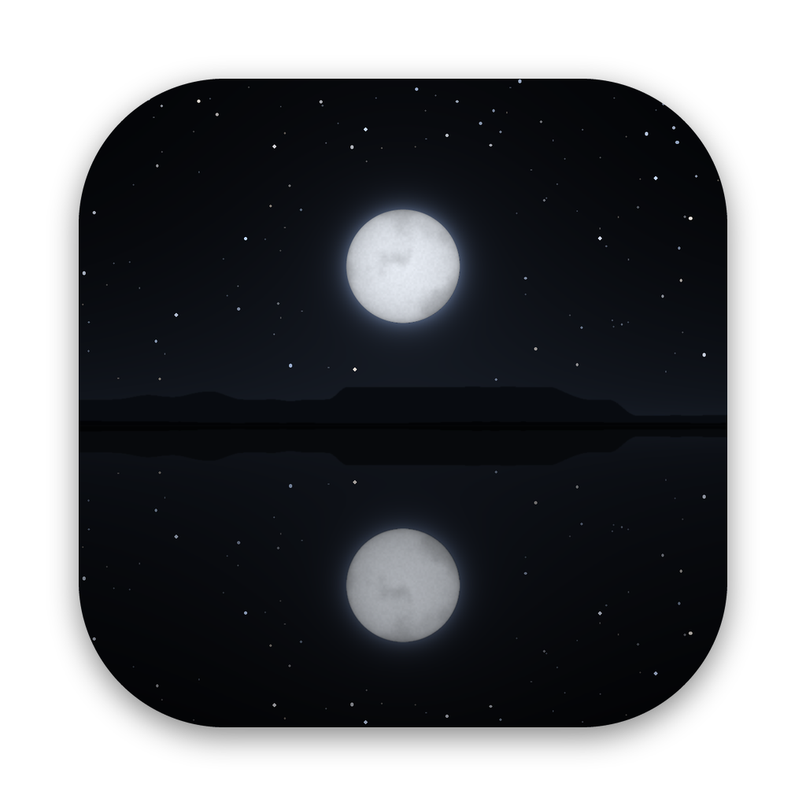

<p align="center">
  
</p>

<h1 align="center">Nullmere Online</h1>

Nullmere Online is a persistent multiplayer 4X for the Mac, for a small
community: one realm, twelve seats round its lake, open to anyone with the
app. Every keeper shares one world, a great dead lake, held by a realm
server. Keepers explore, expand, build up their stores, make pacts and wage
war, and the alliances, politics and
drama they create leave a lasting history. It continues the universe,
premise and principles of [Warpkeep](https://github.com/ael-dev3/Warpkeep),
without Warpkeep's Farcaster identity.

This repository holds one Mac app, **Nullmere Online**: a black lake under
a full moon, with Play, News, Settings, Repository and Quit on the water.
Play crosses to the realm's front door: who you are on the lake, how the
realm stands, and the way in. Inside, you hold a House among other
keepers' Houses: found holds, work the land, train companies, make and
break pacts, and win the age by dominion or by raising the Moonspire.

Website: [nullmere.online](https://nullmere.online)

**Going live** takes five steps that need an account, a Mac or people only
the realm's maintainer has: raising the realm on maincloud, signing and
notarizing the release, hearing the voices and measuring on a Mac with
Apple Intelligence (one command, `scripts/check-on-mac.sh`), listening to
it with VoiceOver, and its first keepers. Each is rehearsed in CI where it
can be, and [docs/GO-LIVE.md](docs/GO-LIVE.md) is a checklist of commands
to paste, each with what it prints when it worked.
`scripts/go-live-status.sh` says where each step stands.

## Requirements

Nullmere Online runs only on Macs that can run Apple's on-device language model,
the roughly 3-billion-parameter model behind Apple Intelligence. Its
envoys and chronicler speak through that model, on your Mac, using the
[Foundation Models](https://developer.apple.com/documentation/foundationmodels)
framework. You need:

- a Mac with Apple silicon,
- macOS 26 Tahoe or later,
- Apple Intelligence turned on in System Settings, with its model downloaded.

The app is built for Apple silicon only and declares macOS 26 as its minimum,
so macOS won't open it anywhere else. On a Mac that meets both but can't use
the model, the launcher shows nothing but what is missing: that the Mac
doesn't support Apple Intelligence, that it is turned off, or that the
model is still downloading. It offers System Settings where that helps, and
Quit. The menu stays closed until the model is ready, and then the launcher
opens by itself. While the answer can still change, it checks again every
few seconds while it is in front, and whenever it comes back to the front.

To build the launcher you need Xcode 26 or later. It includes Swift 6.2 and
the macOS 26 SDK.

## Build and run

From a terminal:

```sh
git clone https://github.com/ael-dev3/Nullmere.git
cd Nullmere
swift run NullmereLauncher
```

From Xcode: open the package with `open Package.swift`, choose the
**NullmereLauncher** scheme and **My Mac**, then press ⌘R.

A realm to play in, hosted on your own Mac for development:

```sh
NULLMERE_REALM=local swift run NullmereLauncher
```

As a double-clickable app:

```sh
make app                          # or: scripts/build-app.sh
open "build/Nullmere Online.app"
```

`scripts/build-app.sh` makes an arm64 release build and assembles
`Nullmere Online.app` with its icon and Info.plist.
The icon is a Liquid Glass document, `Packaging/AppIcon.icon` (night,
reflection and a glass moon), compiled with `actool` into the app's asset
catalog; the classic `AppIcon.png` is the fallback where `actool` isn't
available. Both are drawn by `Tools/icon/make-icon.py`: the launcher's own
still lake, framed square around the moon. It signs the app ad hoc,
which is enough to run it on the Mac that built it. To sign with a
Developer ID instead, set `CODESIGN_IDENTITY`: the app is then signed with
the hardened runtime and a secure timestamp, ready to notarize. `VERSION`
sets the marketing version (default `0.3.0`).

**A release is one command.** `scripts/release.sh` builds the app and
packs it into `build/Nullmere-Online-<version>.dmg`, with a link to
Applications; CI makes this disk image on every run and keeps it. For a
public release, with an Apple Developer ID:

```sh
xcrun notarytool store-credentials nullmere --apple-id … --team-id …   # once
CODESIGN_IDENTITY="Developer ID Application: …" NOTARY_PROFILE=nullmere \
    VERSION=1.0.0 scripts/release.sh   # signs, notarizes and staples
```

Or from GitHub: with the Developer ID certificate and an App Store
Connect API key in the repository's secrets (`MACOS_CERTIFICATE`,
`MACOS_CERTIFICATE_PASSWORD`, `APPLE_API_KEY`, `APPLE_API_KEY_ID`,
`APPLE_API_ISSUER`), pushing a tag such as `v1.0.0` runs
`.github/workflows/release.yml`: it signs, notarizes and staples the disk
image and attaches it to a GitHub release.

CI rehearses that path on every run (`scripts/rehearse-release.sh`): a
throwaway self-signed identity takes the Developer ID's place through the
same steps, the app is signed with the hardened runtime and a secure
timestamp, the disk image is signed, and the notarizing and stapling are
printed rather than sent. Adding the secrets is all that's left, in one
command that checks each file first (docs/GO-LIVE.md, step 2):

```sh
scripts/set-release-secrets.sh DeveloperID.p12 AuthKey_XXXXXXXXXX.p8 <issuer id>
```

Tests and checks:

```sh
swift test                 # unit tests; on a Mac with Metal, the shader is also compiled on the GPU
make check-shader          # compile the lake's and the map's shaders with the offline Metal compiler
make smoke                 # build the app, open the launcher, check it starts and renders with Metal, take a screenshot
make smoke-menu            # open a debug build of the launcher with the model ready, Apple Intelligence off and the model downloading; type into it, photograph every screen
make smoke-game            # open a debug build, press Play, enter a realm hosted on the Mac as a keeper, take screenshots
scripts/ui-test.sh         # through Xcode's UI testing: every screen put to its accessibility audit, the map walked as VoiceOver walks it
```

CI runs all of these on a macOS 26 runner for every pull request and every
push to `main` or a working branch that touches the code, and keeps the
screenshots of the launcher, the realm's front door and the world.

Line coverage is held to a floor for each module, on macOS and, for the
rules, the realm and the launcher's logic, on Linux too (`scripts/coverage.py`). On macOS,
CI's summary lists the files with the most lines no test runs, and the
lines themselves (the command-line entry points, the launcher's and the
steward's, have no floor: CI runs both whole). What remains is mostly what a test can't
reach: `init(coder:)` stubs no window calls, SwiftUI state's initial values,
the fallbacks drawn when Metal or sound fails, the live environment's
closures (downloading the news, opening a link, quitting), trackpad
gestures, and Apple's on-device model, which `scripts/check-on-mac.sh` asks
on a Mac with Apple Intelligence. A few more are reached only by hand: a
menu's items, and VoiceOver's actions on the map (a test process has no
assistive technology to build SwiftUI's accessibility tree for).

The launcher and the game ask the Foundation Models framework through one
`ModelAvailabilityProvider`; tests stand in a fake one and walk every state
(ready, not eligible, Apple Intelligence off, downloading, and a reason
macOS hasn't named), including the launcher and the realm's front door
opening by themselves when the model arrives and closing again when it goes. Debug
builds also take:

| Variable | Effect |
| --- | --- |
| `NULLMERE_MODEL_STATE` | `ready`, `notEligible`, `notEnabled`, `downloading` or `unavailable` instead of asking the framework (`NULLMERE_SKIP_MODEL_CHECK=1` means `ready`) |
| `NULLMERE_LAUNCHER_KEYS` | Keys the launcher receives once its opening is over, such as `right,return` |
| `NULLMERE_NEWS_URL` | Another `https` news feed, such as a branch's copy |
| `NULLMERE_REALM` | `local`: host a realm on this Mac (kept in Application Support); or the `http(s)://server/database` address of another realm, such as `http://127.0.0.1:3000/nullmere` |
| `NULLMERE_REALM_SEED` | The words a newly hosted realm's world grows from |
| `NULLMERE_IDENTITY_FILE` | Keep the keeper's identity in this file instead of the keychain |
| `NULLMERE_KEEPER` | Enter the world at once under this name |
| `NULLMERE_TEXT` | `larger`: show the larger type without remembering it |
| `NULLMERE_SHOW` | With `NULLMERE_KEEPER`: `seat`, `unit`, `houses`, `chronicle`, `guide`: select the seat or a company, open a panel; `briefing`: keep the card a keeper first meets; `watch`: be ready after `NULLMERE_WATCH_AFTER` seconds (12.5) |
| `NULLMERE_AUTOPLAY` | With `NULLMERE_KEEPER`, in a hosted realm: let a steward play the keeper's House this many watches first |
| `NULLMERE_VOICEOVER` | `1`: the map offers its orders to the accessibility tree as when VoiceOver runs, for the UI tests |

Release builds ignore them all and always require the model.

## Using the launcher

| Key | Action |
| --- | --- |
| ← → | Move along the menu, or between the choices on a screen |
| ↑ ↓ | Choose a story in News or a row in Settings |
| Return or Space | Select; in Settings, cycle the option |
| ← → in Settings | Change the selected setting |
| Esc | Go back |
| ⌘, | Settings |
| ⌘Q | Quit |

Any key or click during the opening skips it. Everything also works with the
pointer, and the choice that is lit is always the one Return selects. Holding
Return or Esc acts once. With Keyboard navigation turned on in System
Settings, Tab moves focus between controls and Space presses the focused one.

- **Play** fades the launcher out and crosses to the realm's front door,
  in the same window. The on-device model's status is always shown at the
  bottom left.
- **News** lists the latest stories, with the chosen story beside them.
- **Settings** is described below.
- **Repository** opens this repository in your browser.
- **Quit** fades to black and quits.

### News

The news lives in this repository, in [`news/news.json`](news/news.json):

```json
{
  "items": [
    {
      "id": "full-moon",
      "date": "2026-10-24",
      "title": "A full moon over Nullmere",
      "body": "A few sentences, up to 280 characters.",
      "link": "https://github.com/ael-dev3/Nullmere"
    }
  ]
}
```

When you open News, the launcher downloads that file from the `main` branch
on `raw.githubusercontent.com`, at most once every ten minutes while it is
open, and saves the copy for the next launch. Offline, or while the
repository is private, it shows the saved copy, or the news it was built
with. Stories are listed newest first. Entries without a title, body or
valid date are skipped, and only `https` links are followed. The download
carries no cookies or identifiers, though GitHub sees your IP address as it
would for any web request. A test keeps the built-in news identical to the
file, so publishing news means editing `news/news.json` and the built-in copy
in [`News.swift`](Sources/LauncherCore/News.swift) together.

### Settings

Settings are stored in the app's user defaults (`online.nullmere.launcher`;
a `swift run` build keeps its own, under `NullmereLauncher`). The display
settings are one set, shown in the launcher's Settings and in the realm's
(⌘, at the front door or in the world), and the lake and the map both
follow them:

| Setting | Options | Effect |
| --- | --- | --- |
| Motion | System, Full, Reduced, Still | How much the lake and the map move. Full: flickering and falling stars, the opening, marches and blows played out, panels sliding in. Reduced: slower, gentler twinkling and water, no falling stars, no opening; marches and blows shown where they end, panels fading in. Still: a single frame, drawn again only when something changes. System follows *Reduce Motion*. |
| Resolution | Native, Balanced, Efficient | Renders the lake at 100%, 75% or 50% of native pixels, and the map at most at that |
| Frame rate | 30, 60, 120 | Upper bound for the lake's and the map's frame rate. Reduced motion, Low Power Mode, a Mac running hot, or another app in front lowers it to 30 |
| Text | Standard, Larger | Larger sets all the type a fifth larger, the launcher's and the game's, none of it under eleven points. ⇧⌘+ in the Watch menu sets it too |
| Full screen at launch | Off, On | Applies the next time the launcher opens |

The realm's Settings also hold its sound (on or off, the effects, the
night, the music and its score's volume) and counsel. The
launcher makes no sound; ⇧⌘M and ⇧⌘U turn sound and music off or on once
the realm shows.

## The realm

Nullmere Online is one world shared by every keeper: the realm holds it,
and the client on your Mac holds a copy, carries out your orders at once
as the realm will, and takes the realm's word as final.

- **The front door.** Choose the name you'll go by: two to twenty letters.
  It names you and the House you'll hold, and nothing else is asked. The
  realm knows you by an identity your Mac keeps in its keychain, and by
  your name. The front door, set on the water as the launcher's panels
  are, shows the realm's state: its age and watch, how many keepers are
  there, and how many seats are open. Its choices are the launcher's: one
  lit at a time, the one Return takes, the arrows moving along them and
  Esc going back. Entering seats you in a middling House of
  those open (at an age's start, all alike, the first); returning, you go
  straight back to yours. No newcomer may take up a House sworn to another,
  the House leading the lake, or one within reach of dominion or with its
  Moonspire risen.
- **Seats.** The lake has twelve seats. Seats no keeper holds are played by
  stewards, the same minds that once played rivals, until a keeper claims
  them. When every seat is held, a newcomer waits at the front door and
  steps in the moment one falls free. A seat whose keeper has been away a
  week goes back to the stewards for whoever is waiting (a day, for a seat
  taken and never played); its House stands as it was, and the keeper,
  returning, waits in turn. Meanwhile, after two watches away (counted in
  watches, however quickly they turn), a caretaker keeps the House: it
  answers envoys, builds and trains, guards the holds, fights on in wars
  already begun and sues for peace in one going badly, but begins no war,
  demand or pact and never bends the knee, though it takes a House offering
  fealty as a vassal. A pact offered it swears as a steward would, but
  never with a House at war with the keeper's allies or one whose Moonspire
  is rising. While fewer than half the keepers are there, a watch lasts at
  least a third of its time, however ready they are.
- **Fair seats.** Seats are spread evenly round the lake, none hemmed in
  with little land of its own; which House takes which is the luck of the
  draw, and the stewards take their turns starting one seat further round
  the lake each watch.
- **What you see.** The realm tells each keeper only what their House
  could know: the ground they've explored, the companies in their sight,
  their own stores, and the envoys and news that reach them. The world
  itself never leaves the server.
- **Gifts.** Send stores to any House you aren't at war with. Stewards
  remember gifts for twenty watches: a war seems older to them, and enough
  goodwill wins a pact, unless you once made war on them or a pact between
  you was broken. A keeper hears of a gift, a war declared or an
  envoy sent the moment it happens, not when the watch turns.
- **Trade.** Offer any House you aren't at war with so much of one store
  for so much of another. Stewards weigh it by barter worth, the cunning
  asking most; allies, givers of gifts and a House short of what you offer
  ask less, though never below even, and none trades away the grain its
  companies need. A keeper
  answers by envoy. Stewards trade among themselves before bartering at
  three to one. The answer is always the realm's: your copy of the world
  can't see the others' stores, so it doesn't guess.
- **Who is there.** The front door names the keepers in the realm now,
  and each House in the Houses panel says who gives its orders: its
  keeper, here or away, or a steward.
- **Taking your seat.** The first time you enter an age, a card tells
  you the House you take up (its seat and holds, its strength among the
  Houses, its wars and pacts, which the stewards may have chosen for you)
  and the first three things to do. Those three then stay beside the map
  as a checklist, ticked as you do them, until all are done.
- **Coming back.** Return after watches have passed, and a card tells
  what happened while you were away: your stores and holds, and the news
  that touched your House.
- **What can't be undone asks twice.** Declaring war, breaking a pact,
  disbanding a company and refusing a steward's demand for tribute each want
  a second press within three seconds (ten while VoiceOver runs).
- **Elsewhere.** While you are in another app, the Dock counts the
  watches that turned, and bounces once when something needs you.
- **The watch.** Each turn is a watch. Your orders take effect as you give
  them; say you're ready (⌘↩) when they're given. The watch turns when
  every keeper there is ready, or when its time runs out, three minutes;
  then the stewards act, and the lake yields, eats and mends. An empty
  realm sleeps until a keeper returns. Leave, and after two watches away a
  caretaker keeps your House.
- **Treating with keepers.** Offers to another keeper wait as envoys for
  their answer, as theirs wait for yours. Envoys of stewards speak, in
  words written on your Mac; a keeper's envoy carries their own words, if
  they write any: one plain line, no addresses, read by that keeper alone.
  Hide a House's words from its envoy card; your Mac remembers.
- **Omens.** Now and then the lake turns for every House at once, for
  three to five watches: Moonsalt Bloom doubles moonsalt, Rising Mist shortens
  every sight by a tile, a Lean Watch takes a third of the grain, and a
  Still Night mends wards twice as fast. The chronicle tells when one
  falls and lifts, and a band under the top bar shows it while it lasts.
- **Where it comes from.** Press a store in the top bar for its account:
  what each hold yields a watch, what your companies eat, what an omen
  adds or takes, and the room left to keep it.
- **Ages.** When a House wins, the age ends. When the watch next turns, a
  new age begins on a fresh lake, and keepers are seated anew in the order
  they first came, as seats allow, but for any away longer than a seat is
  kept for them. Each age's lake has a shape of its own, in turn:
  the round Nullmere, the Twin Waters with a neck of land between them,
  the Sickle with land pushing in from one shore, and the Drowned Isles.
  The front door names the lake of the age, and the moon lies in the
  deepest water of each.
- **The server.** SpacetimeDB is the realm's authority of record: it knows
  each keeper by their identity, keeps the world, and lets no one but the
  steward write it. The steward runs the same Swift rules core the clients
  carry, so there is one set of rules. A keeper's client carries out their
  orders at once, as the realm will, and takes the realm's word as final.
  Your identity is made once and kept in your keychain. For
  development a realm can also be hosted in-process (`NULLMERE_REALM=local`).

### Raising the realm

The realm proper is a [SpacetimeDB](https://spacetimedb.com) database with
the module in `realm-server/`, and a steward beside it running the rules.
Release builds go to `https://maincloud.spacetimedb.com/nullmere`.

**Going live is one command**, after signing in to SpacetimeDB once:

```sh
spacetime login                                # once: opens a GitHub sign-in
scripts/raise-realm.sh maincloud --dry-run     # optional: checks and builds everything, changes nothing
scripts/raise-realm.sh maincloud               # publishes the module, starts the steward
```

When the steward is up, the script reads the realm's status back as any
keeper would, and fails if the realm doesn't answer. CI runs the dry run
for maincloud, and raises a whole realm standing alone on its own
SpacetimeDB the same way (`scripts/raise-realm.sh local`, then `--stop`).

The script checks its tools, publishes the module, keeps the steward's
token in `~/.config/nullmere` (readable by you alone), and starts the
steward: for maincloud, in a container (`Dockerfile.steward`, restarted with
the machine) when Docker is there; otherwise, and always for a local realm,
in the background, with its log beside the token. Run it again to update the module; the realm keeps its world. Ask
for a fresh realm with `SPACETIME_CLEAR=1`.

The module can also be published from GitHub: put the token
`spacetime login show --token` prints in the `SPACETIME_TOKEN` secret, and
run **Publish the realm** (`.github/workflows/realm.yml`) from the Actions
tab. The steward still runs on a machine of yours, as that identity.

If the name `nullmere` is taken on maincloud, choose another with
`REALM_DB=…`, and build the app for it with
`REALM_ADDRESS=https://maincloud.spacetimedb.com/<name> scripts/build-app.sh`;
the address is kept in the app's Info.plist. `NULLMERE_REALM_NAME`,
`NULLMERE_REALM_SEED`, `NULLMERE_REALM_SEATS` and `NULLMERE_WATCH_SECONDS`
shape a new realm; `STEWARD=foreground` keeps the steward in the terminal.

`scripts/raise-realm.sh local` raises the same realm on your own machine
(starting SpacetimeDB if it isn't running); open a debug build with
`NULLMERE_REALM=http://127.0.0.1:3000/nullmere`. CI runs this very script:
on Linux, two keepers play through the server; on macOS, the app itself
enters the world across the network (`scripts/smoke-test-network.sh`).

The steward takes up the realm where it stands after a restart. The
realm's tables are private: keepers write requests through reducers and
read only their own view and replies, through SpacetimeDB views
(`my_view`, `my_replies`), and the realm's public status. A keeper may
have 32 requests waiting at most, and the steward carries out a few of
each keeper's every round, so no one keeper can crowd out the rest. A
request sent again, after its answer was lost, is carried out once. The
steward keeps the world and gives its answers in one transaction, so a
round it couldn't publish, or a steward stopped mid-round, loses and
doubles nothing; it says when a round fails, and every ten minutes how
the realm stands. One steward holds the realm at a time: any other finds it
held, tries again for two and a half minutes (a steward started again
waits the minute its old hold takes to lapse), then gives up. A container
is restarted after it, so stop a second one with `--stop`. The server
stamps each publication by its own clock, so a keeper arriving mid-watch
sees the watch's true time left, whatever their own clock says. If the
steward falls silent for a minute, every keeper is told the realm stands
still, and told again when it returns. An order that reached the realm
waits there for its answer, however long; one that can't reach it within
five minutes is let go, and its keeper told. Past those five minutes an
order is never sent again, only asked after, so none is carried out
twice.

## Playing Nullmere Online

- **The land.** Strand, salt flats, greyfields, blackwood and barrows ring
  the lake. Each yields grain, timber, stone or moonsalt to the hold whose
  territory it lies in; groves, seams, loam and moonsalt beds yield more.
  The Still, the lake's deep water, yields nothing and cannot be crossed;
  the shallows can.
  Drowned ruins hide something for the first company to search them.
- **Holds** gather what their land yields and store it, up to a limit that
  grows with each hold. Build Granaries, Sawpits, Quarries and Saltworks to
  boost a store, Walls to thicken the ward, Beacons to see further (at
  level II, a hold's land reaches a tile further too), and a Muster Hall to
  train stronger companies, and at level III to train all but Lanterns a
  watch sooner. Barter a surplus
  for what you lack, three to one. Each new hold costs more to found than
  the last, so a House grows by choice, not by habit.
- **Companies.** Lanterns scout, Spears hold the line and take holds,
  Bows strike from two tiles, Riders are fast, and Founders found new holds.
  Every company but Lanterns eats a grain each watch. Companies that
  live through battles rise in rank (Blooded, Hardened, Sworn), each rank
  adding a tenth to attack and defence; chevrons under a token show it.
- **Houses.** Other Houses are held by keepers, or by stewards with
  temperaments: ambitious, steadfast, wary or cunning. Declare war, offer
  peace or a pact, and answer envoys. Pacts share sight; breaking one is
  remembered.
- **Conquest.** Taking a hold carries off its share of the loser's stores;
  a seat holds half of them. A House that loses its seat is shaken: every
  hold it has left loses most of its ward. A House that loses every hold
  falls, and its name passes into the chronicle.
- **Winning.** Raise the five stages of the **Moonspire** at your seat
  (ascendancy), or rule the lake (dominion): five of every twenty holds and
  at least ten, your vassals' counted with your own, or be the last House
  standing. Stewards fear every rising Moonspire and will march on it, and
  begin one only with the holds to store its last stage, or as the most
  renowned House on the lake.
- **Fealty.** A steward's House that loses its seat with four holds or
  fewer left, and no vassals of its own, bends the knee to the House that
  took it, if that House is sworn to no one; and a beaten House may offer
  fealty rather than fall. A vassal's holds count with its liege's and it
  can never turn on its liege; a liege who turns on a vassal frees it, and
  a liege's fall frees all its vassals. A far stronger steward will not
  make peace until the war has run long.
- **How ages end.** In 528 ages played through by stewards alone, the
  Moonspire decided seven in ten and dominion the rest; an age ran 157
  watches at the median, and two in five saw a House fall outright. The
  seats won alike, within chance. The tempers win differently: the
  ambitious (37%) and the cunning (28%), quick to war, take most
  dominions, while the steadfast (17%) and the wary (19%) win almost only by
  the Moonspire.
- **Tribute.** From watch twenty, an ambitious or cunning steward a quarter
  stronger than a neighbour may demand a fifth of its stores. Paid, it keeps
  the peace for twenty watches, unless that neighbour's Moonspire rises;
  refused or ignored, it marches. You can demand tribute too: a keeper who
  refuses you owes nothing more, and war is yours to choose.
- **The race.** The Houses panel shows each House's holds towards dominion
  and its Moonspire's stages, and the game warns you, once, whenever any
  House comes near the end of either road. At the end of an age, a chart
  tells its story: every House's holds, watch by watch.
- **Battle.** Attackers lean into their blows, the struck shake, Bows'
  shots cross the gap, and the fallen fade where they stood.

- **Voices.** Envoys speak to you, and a chronicler writes beneath the
  moments that touch your House, in words written on your Mac by Apple's
  on-device model. They only speak; the rules decide everything.

- **Sound and music.** A cold drone and the night wind over the water, a
  low bell as each watch turns, and quiet cues, all synthesised as they
  play. Beneath them an original score is written as it plays: slow chords
  in D minor drifting under a sparse line of bell-like notes, joined at war
  by a distant drum and darker chords. ⇧⌘M turns all sound off, ⇧⌘U the
  music alone, and Settings (⌘,) sets each part's volume. Each kind of
  company sounds its own: Riders' hooves, a loosed bowstring, the clash
  of a blow struck in close, heard as well when the blow falls on yours.
  A company lost or hungry sounds dread, a work or company finished rises,
  and an order that begins a war sounds as war, refusing a steward's
  tribute too. Sound fades out with the picture and back in from silence.
- **Watchmen.** When an enemy's companies gather near one of your holds,
  you're told, and a broken red ring marks the hold on the map.
- **Holds that grow.** A hold raises a side tower after a few works and a
  second after many, so a glance at the map shows which holds are built up.

Larger text (Text in either Settings, or ⇧⌘+ in the Watch menu) sets all
the type a fifth larger, the launcher's and the game's, none of it under
eleven points; the panels grow to hold it. Every text reads by one rule
of contrast, in the launcher as in the game: never fainter than 4.5 to 1
over the dark and, with Increase Contrast, 10 to 1 or more, the fainter
still fainter. VoiceOver reads the map, the panels and every notice.

Each age's lake grows from the realm's private words; the realm keeps the
world, so there is nothing to save.

| Key | Action |
| --- | --- |
| Click | Select a company, hold or tile |
| Right-click | March the selected company there, or strike the enemy there. Hovering an enemy in reach shows the battle's odds first |
| Drag, two-finger scroll | Pan; pinch, ⌘-scroll or a mouse wheel zooms |
| Tab or . | Next company waiting for orders |
| F / B | Fortify / found a hold with the selected Founders |
| M | March the selected company to the middle of the view, or strike there: play without a pointer |
| H | Go to your seat |
| Arrows or WASD, + − | Pan, zoom |
| 1 / 2 / ? or ⌘? | Houses / Chronicle / Guide |
| Esc | Close a panel, then clear the selection |
| ⌘↩ | Ready: done with this watch's orders (click Waiting to take it back) |
| ⇧⌘↩ | Stay ready until something needs you, up to ten watches |
| ⌘, | Settings: display and text (the launcher's), sound and volumes, counsel |
| ⇧⌘M / ⇧⌘U / ⇧⌘+ | Sound on or off / the music / larger text |
| ⇧⌘W | Leave the world for the front door |

## Design

A full moon hangs over a great black lake. The water below gives it back
whole, still as black glass. Pale, thin type rests above the far shore. The mood is
vast, quiet and monumental, after the grand, minimal look of the Dune films.
There is no music in the launcher; the game makes its own sound as it plays.

- **The moon** is a large, cold full moon at the top of the sky, the same
  view as the app icon. Its halo swells and settles very slowly, and thin
  haze drifting past catches its light.
- **The stars** flicker, each at its own pace, warm or cold. They flicker
  more near the horizon, as they do through deeper air. Now and then a star
  falls: the first a few seconds after the lake appears, then at random,
  about once in a minute and a half, drawing a fading trail away from the
  moon.
- **The lake is dead, deep and still.** Nothing stirs it: it gives back the
  sky exactly, the moon whole with its rim as clean as above, and every
  star where it stands, falling stars too. It shows itself only by giving
  back a little less light as it nears, and by the mist and the hairline of
  light where it meets the far shore.
- **The title** is NULLMERE ONLINE on a single line, set in SF Pro Thin
  with wide tracking, and nothing else. The letters settle together as it
  appears. The menu is a single row of
  light, spaced capitals on the water, and the chosen word glows faintly
  over a hairline. Panels darken the water beneath them so their text stays
  legible over the reflection.
- **Rendering.** One fragment shader draws the whole scene procedurally. It
  is compiled at runtime from
  [`LakeShader.swift`](Sources/LauncherKit/Backdrop/LakeShader.swift), so plain
  `swift build` works. Stars are sized in points, so they stay crisp at any
  window size or backing scale, and the output is dithered so the dark
  gradients don't band.
- **Cost.** The lake renders only while the window is visible and motion is
  allowed, at the chosen frame rate and resolution. It drops to 30 frames a
  second while another app is in front, in Low Power Mode, and when the Mac
  runs hot. If the shader fails, a still SwiftUI painting of the scene
  replaces it.
- **Accessibility.** The launcher honours Reduce Motion and Increase
  Contrast, reads its type at the game's Larger Text, has VoiceOver labels
  and selection traits, and works fully from the keyboard.

### Tuning the scene in a browser

The scene section of the shader is written in the subset shared by Metal and
GLSL, so it can be previewed without rebuilding the app:

```sh
python3 -m http.server
# open http://localhost:8000/Tools/scene-preview/
```

Query parameters: `horizon`, `activity` (1 for full motion, 0.4 reduced,
0 still) and `time`, which freezes a moment. Try `?time=7.2` to catch the
first falling star.

The world map's shader is written the same way. Its preview reads the tile
texture the game would, written for a keeper at an age's opening and for
the whole world known:

```sh
scripts/world-preview-data.sh
python3 -m http.server
# open http://localhost:8000/Tools/world-preview/?data=../../build/world-preview/opening.json
```

Query parameters: `scale` (points per world unit, 28 as an age opens),
`x` and `y` (the view's centre; the seat by default, `x=moon` for the
moon's reflection) and `time`.

## Layout

```
Package.swift
Sources/
  LauncherCore/       Platform-independent logic: settings, navigation, news, model readiness, composition
  LauncherKit/        SwiftUI interface, Metal backdrop, services (on-device model, news)
  NullmereLauncher/   The Nullmere Online app's entry point
  NullmereCore/       The rules and the realm's authority: world generation, economy, war, diplomacy, stewards, keepers, watches, ages. Pure, deterministic Swift
  NullmereRealm/      The client's line to the realm over SpacetimeDB or in-process, the steward, keeper identity. Foundation only
  NullmereKit/        The world's interface: front door, Metal world, panels, sound
  NullmereSteward/    The steward's command-line entry point
Tests/                LauncherCoreTests, LauncherKitTests, NullmereCoreTests, NullmereRealmTests, NullmereKitTests, and NullmereTestSupport (a SpacetimeDB in memory)
realm-server/         The SpacetimeDB module (Rust): keepers, requests, answers, the world
Dockerfile.steward    The steward in a container, as raise-realm.sh runs it
news/                 news.json, the launcher's news feed
perf/                 CI's performance baseline; scripts/measure-mac.sh adds figures from real Macs in perf/mac/
Packaging/            The Info.plist template, the Liquid Glass icon (AppIcon.icon) and the classic 1024 px icon
scripts/              Building, packing and checking a release; smoke tests; raising the realm; going live
Tools/icon/           Draws the icon, its Liquid Glass layers and the classic one (make-icon.py)
Tools/scene-preview/  Browser preview of the lake shader
Tools/world-preview/  Browser preview of the world map's tiles
docs/                 Going live; the consistency audit of October 2026 (docs/audit/); the plan made before the build for what carries over from Warpkeep
```

## Direction

- **Client:** native Swift on macOS, using SwiftUI and AppKit for the
  interface, and Metal for the lake and the world.
- **Server:** [SpacetimeDB](https://spacetimedb.com) as the authoritative
  multiplayer backend, as it was for Warpkeep.
- **Characters:** non-player characters voiced by Apple's on-device model,
  through the Foundation Models framework. They never decide outcomes or
  grant stores.
- **Character:** open source and pseudonymous, executed with restraint.

[What carries over from Warpkeep](docs/warpkeep-carryover.md), a plan
written before the build, covers the universe, principles and asset
licensing, and says where the build went another way.

## Licence

- Code is licensed under the [Apache License 2.0](LICENSE).
- Original art and documentation, including the app icon, are dedicated to
  the public domain under [CC0 1.0](LICENSE-CC0-1.0).
- The Nullmere name and nullmere.online identify the official project. Neither
  licence grants rights to them.
